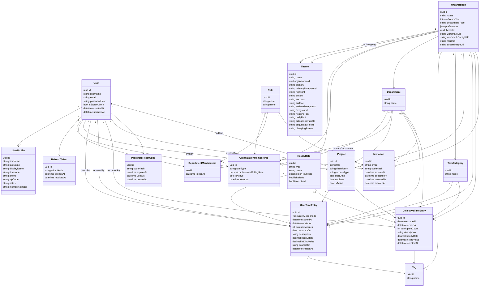

# Clocked In domain schema

This document is the source of truth for the Clocked In domain. The Next.js app queries it with Prisma, and the .NET app queries it with Entity Framework. Both backends share one Postgres database. Entity Framework owns migrations. This document does not define HTTP routes.

An environment variable will later choose which API the Next.js server actions call. Both APIs use the same request and response contracts and the same JWT rules (shared issuer, audience, and signing key). Users and refresh tokens live in the shared database.

Identifiers are UUIDs. Instants are `timestamptz`. `username` and `email` are stored lowercase and are unique. Money rates use `decimal(10,2)`. In-kind totals use `decimal(12,2)`.

CASWJ workbook mapping: the umbrella org is one `Organization`; spreadsheet Groups are `Department`; free-form log Tags stay org-scoped `Tag`. Entry notes are the `description` field.

## Model

`TimeEntryMode` is `Punch`, `Duration`, or `Total`. Seed `Role.code` with `MEMBER`, `VOLUNTEER`, and `ADMIN`. The same role rows are used on organization and department memberships. `HourlyRate.type`, `defaultRateType`, and membership `rateType` are `Volunteer` or `Professional` (stored as text). `accessType` is `Public`, `Private`, or `Department` (stored as text). `headingFont` and `bodyFont` are `SourceSans3`, `NunitoSans`, or `Geist`. Tag and project-editor links are many-to-many; join tables are not domain entities. Color fields are `#RRGGBB`.

## Entities

Foreign keys below are the relationship ends from the diagram. Tag and project-editor links are a many-to-many. Prisma and EF may use an implicit join; those join tables are not domain entities.

### User

| Field | Required | Notes |
| --- | --- | --- |
| id | yes | UUID primary key |
| username | yes | Unique, stored lowercase. Login identifier |
| email | yes | Unique, stored lowercase |
| passwordHash | yes | Hash only. Never store the password |
| isSuperAdmin | yes | Default false. User-level flag, not a membership role. Bypasses membership checks |
| createdAt | yes | |
| updatedAt | yes | |

### UserProfile

One profile per user. `timezone` is an IANA name and defaults to `UTC`. `displayName`, `phone`, `zipCode`, and `notes` are optional. `firstName` and `lastName` are required. Rate type and professional rate live on `OrganizationMembership`, not on the profile. `memberNumber` is an optional Volunteer ID (`001`…).

| Field | Required | Notes |
| --- | --- | --- |
| id | yes | UUID primary key |
| userId | yes | Unique foreign key to User |
| firstName | yes | |
| lastName | yes | |
| displayName | no | |
| timezone | yes | IANA name, default `UTC` |
| phone | no | |
| zipCode | no | Workbook Zip Code |
| notes | no | |
| memberNumber | no | Volunteer ID shown on the Volunteer Log CSV |

### Role

Lookup shared by organization and department memberships. Seed two rows: `MEMBER` and `ADMIN`.

| Field | Required | Notes |
| --- | --- | --- |
| id | yes | UUID primary key |
| code | yes | Unique. `MEMBER` or `ADMIN` |
| name | yes | Display name |

### Organization

In-kind valuation catalogs live on `HourlyRate`. Creating an organization seeds `rateSourceYear` `2025`, `defaultRateType` `Volunteer`, and one default volunteer `HourlyRate` named `Volunteer` at `35.47`. The HTTP organization still exposes `volunteerHourlyRate` as that default rate.

| Field | Required | Notes |
| --- | --- | --- |
| id | yes | UUID primary key |
| name | yes | |
| rateSourceYear | yes | Integer year, default `2025` |
| defaultRateType | yes | `Volunteer` or `Professional`, default `Volunteer` |
| preferences | yes | jsonb. `allowTimeEntryEditing` defaults to false. When false, a time entry update cannot change `startedAt`, `endedAt`, `durationMinutes`, or `occurredOn`. `entityLabels` holds display names for `organization`, `project`, `department`, and `taskCategory` (defaults: Organization, Project, Department, Task category). |
| themeId | yes | Foreign key to Theme. Defaults to the seeded Clocked In global theme. |
| wordmarkUrl | no | Light-on-dark sidebar wordmark. Stays on the organization so switching themes does not wipe marks. Uploads are resized to fit 800×200, stored privately, and served at `/brand/wordmark` for members. |
| wordmarkOnLightUrl | no | Dark-on-light wordmark for light surfaces. Same resize and private storage as `wordmarkUrl`, served at `/brand/wordmarkOnLight`. |
| markUrl | no | Compact mark for favicon-sized use. Uploads are cropped to 64×64, stored privately, and served at `/brand/mark` for members. |
| accentImageUrl | no | Decorative image for login, enrollment, empty states, and header bands, never behind tables or forms |

### Theme

Global presets have `organizationId` empty and are read-only. Organizations can save named copies. Palettes are JSON arrays of `#RRGGBB` colors: categorical 6–8, sequential 5–7, diverging 7. Seed seven global themes: Clocked In, Harbor, Atelier, Evergreen, Orchid, Okabe–Ito, and Tol Bright.

| Field | Required | Notes |
| --- | --- | --- |
| id | yes | UUID primary key |
| name | yes | |
| organizationId | no | Empty for a global preset. Set for an org-saved theme |
| primary | yes | `#RRGGBB`. Sidebar, headings, primary buttons |
| primaryForeground | yes | `#RRGGBB`. Text on primary |
| highlight | yes | `#RRGGBB`. Emphasis and active nav, not body text |
| accent | yes | `#RRGGBB`. Small accents |
| success | yes | `#RRGGBB`. Success states |
| surface | yes | `#RRGGBB`. Canvas and cards |
| surfaceForeground | yes | `#RRGGBB`. Text on surface |
| foreground | yes | `#RRGGBB`. Body text |
| headingFont | yes | `SourceSans3`, `NunitoSans`, or `Geist` |
| bodyFont | yes | `SourceSans3`, `NunitoSans`, or `Geist` |
| categoricalPalette | yes | JSON array of 6–8 `#RRGGBB` colors |
| sequentialPalette | yes | JSON array of 5–7 `#RRGGBB` colors |
| divergingPalette | yes | JSON array of 7 `#RRGGBB` colors |

### HourlyRate

An organization-scoped catalog of rates. Names are unique within that organization, compared case-insensitively. Exactly one volunteer rate per organization has `isDefault` true.

| Field | Required | Notes |
| --- | --- | --- |
| id | yes | UUID primary key |
| organizationId | yes | Foreign key to Organization |
| type | yes | `Volunteer` or `Professional` |
| name | yes | Unique per organization, case-insensitive |
| perHourRate | yes | decimal(10,2), greater than zero |
| isDefault | yes | Default false. True only when `type` is `Volunteer`. One default volunteer rate per organization |
| isArchived | yes | Default false. Archived rates stay on the organization and cannot be selected for new entries. The default volunteer rate cannot be archived |

### OrganizationMembership

A user has at most one membership in a given organization. A person may belong to more than one department through `DepartmentMembership`. `primaryDepartmentId`, when set, is a department of this organization and is only the default on the log form. Membership `rateType` and `professionalBillingRate` are kept on the membership and do not set time-entry rates.

| Field | Required | Notes |
| --- | --- | --- |
| id | yes | UUID primary key |
| userId | yes | Foreign key to User. Unique with organizationId |
| organizationId | yes | Foreign key to Organization. Unique with userId |
| roleId | yes | Foreign key to Role |
| rateType | yes | `Volunteer` or `Professional`. Default from the org’s `defaultRateType` at join time |
| professionalBillingRate | no | decimal(10,2). Required and greater than zero when `Professional`; empty when `Volunteer` |
| isActive | yes | Default true. Workbook Active? without deleting history |
| primaryDepartmentId | no | Foreign key to Department. Cleared when that department is deleted |
| joinedAt | yes | |

### Department

A department belongs to exactly one organization. Names are unique within that organization, compared case-insensitively.

| Field | Required | Notes |
| --- | --- | --- |
| id | yes | UUID primary key |
| organizationId | yes | Foreign key to Organization |
| name | yes | Unique per organization, case-insensitive |

### DepartmentMembership

A user has at most one membership in a given department and may belong to many departments in the same organization. The user must already belong to that department’s organization.

| Field | Required | Notes |
| --- | --- | --- |
| id | yes | UUID primary key |
| userId | yes | Foreign key to User. Unique with departmentId |
| departmentId | yes | Foreign key to Department. Unique with userId |
| roleId | yes | Foreign key to Role |
| joinedAt | yes | |

### Tag

A tag belongs to one organization. Names are unique within that organization, compared case-insensitively.

| Field | Required | Notes |
| --- | --- | --- |
| id | yes | UUID primary key |
| organizationId | yes | Foreign key to Organization |
| name | yes | Unique per organization, case-insensitive |

### TaskCategory

An org-scoped lookup, same uniqueness pattern as Tag. Each organization creates its own categories (for example Board Hours, Committee Member Hours, Participant Hours, Volunteer Hours). Not globally seeded.

| Field | Required | Notes |
| --- | --- | --- |
| id | yes | UUID primary key |
| organizationId | yes | Foreign key to Organization |
| name | yes | Unique per organization, case-insensitive |

### Project

A project belongs to an organization. When `accessType` is `Department`, it also belongs to one of that organization’s departments. Workbook “General / No Specific Project” is a normal project row the organization creates; the schema does not auto-seed it.

| Field | Required | Notes |
| --- | --- | --- |
| id | yes | UUID primary key |
| organizationId | yes | Foreign key to Organization |
| departmentId | no | Foreign key to Department. Set only when `accessType` is `Department` |
| ownerUserId | yes | Foreign key to User. The creator in normal use. Can edit; not duplicated in the editor list |
| title | yes | Unique per organization, case-insensitive |
| description | no | |
| accessType | yes | `Public`, `Private`, or `Department` |
| startDate | no | Calendar date |
| endDate | no | Calendar date. When both dates are set, on or after startDate |
| isActive | yes | Default true |

Editors are a many-to-many with User. The join table is not a domain entity.

### UserTimeEntry

Personal time for one user, against an organization or one of its departments. `userId` is whose hours they are. `enteredByUserId` is who created the row (may equal `userId`). `description` is optional notes. Tags are optional and must belong to the entry’s organization. Project and task category are required and must belong to the entry’s organization.

| Field | Required | Notes |
| --- | --- | --- |
| id | yes | UUID primary key |
| userId | yes | Foreign key to User. Whose hours |
| enteredByUserId | yes | Foreign key to User. Who entered the row |
| organizationId | yes | Foreign key to Organization. Always set |
| departmentId | no | Foreign key to Department. Empty for organization-level time |
| projectId | yes | Foreign key to Project |
| taskCategoryId | yes | Foreign key to TaskCategory |
| mode | yes | `Punch`, `Duration`, or `Total` |
| startedAt | no | Required for `Punch`. See time-entry rules |
| endedAt | no | Empty while a punch is open |
| durationMinutes | no | Whole minutes. Required for `Duration` and `Total` |
| occurredOn | yes | Calendar date the time applies to |
| description | no | Notes |
| hourlyRateId | no | Foreign key to HourlyRate. Set at write time |
| hourlyRate | yes | decimal(10,2), zero or greater. Snapshot of the selected rate |
| inKindValue | no | decimal(12,2). Empty only while a punch is open |
| sourceRef | no | Unique when set. Idempotent import key. Empty for entries created in the app |
| createdAt | yes | When the row was entered |

### CollectiveTimeEntry

Group time recorded by an admin. It is not calculated from user entries. `description` is optional. Tags are optional and must belong to the entry’s organization. Project and task category are required.

| Field | Required | Notes |
| --- | --- | --- |
| id | yes | UUID primary key |
| recordedByUserId | yes | Foreign key to User. The admin who recorded the session |
| organizationId | yes | Foreign key to Organization. Always set |
| departmentId | no | Foreign key to Department. Empty for organization-level time |
| projectId | yes | Foreign key to Project |
| taskCategoryId | yes | Foreign key to TaskCategory |
| startedAt | yes | Time in |
| endedAt | yes | Time out. Must be after startedAt |
| participantCount | yes | Integer, at least 1 |
| description | no | Notes |
| hourlyRateId | no | Foreign key to HourlyRate. Set at write time |
| hourlyRate | yes | decimal(10,2), greater than zero. Snapshot of the selected rate |
| inKindValue | yes | decimal(12,2). Elapsed hours × participantCount × hourlyRate, rounded to cents |
| createdAt | yes | When the row was entered |

### RefreshToken

Stores a hash of the refresh token so a backend can end a session. Access tokens are stateless JWTs and are not a table.

| Field | Required | Notes |
| --- | --- | --- |
| id | yes | UUID primary key |
| userId | yes | Foreign key to User |
| tokenHash | yes | Unique hash of the refresh token |
| expiresAt | yes | |
| revokedAt | no | Set when the session is ended |

### Invitation

A pending invite to one organization, or to one department of that organization. `departmentId` is empty for an organization invite. The emailed code is stored only as `codeHash`. `roleId` is `MEMBER` or `ADMIN`.

One pending invite is allowed per email and target. Pending means `acceptedAt` and `revokedAt` are both empty. That rule is a partial unique index.

| Field | Required | Notes |
| --- | --- | --- |
| id | yes | UUID primary key |
| email | yes | Stored lowercase. The account that may accept |
| organizationId | yes | Foreign key to Organization |
| departmentId | no | Foreign key to Department. Empty for an organization invite. When set, the department belongs to organizationId |
| roleId | yes | Foreign key to Role |
| codeHash | yes | Unique hash of the emailed code |
| invitedByUserId | yes | Foreign key to User |
| expiresAt | yes | |
| acceptedAt | no | Set when the invite is accepted |
| revokedAt | no | Set when an admin revokes the invite |
| createdAt | yes | |

### PasswordResetCode

A single-use forgot-password code. Only `codeHash` is stored.

| Field | Required | Notes |
| --- | --- | --- |
| id | yes | UUID primary key |
| userId | yes | Foreign key to User |
| codeHash | yes | Unique hash of the emailed code |
| expiresAt | yes | |
| usedAt | no | Set when the code is consumed or replaced |
| createdAt | yes | |

## Membership rules

- A department belongs to exactly one organization. Department names are unique within that organization.
- A user has at most one membership per organization and per department.
- A department membership is allowed only when that user already belongs to the department’s organization.
- Roles do not inherit. An organization admin is not automatically a department admin.
- An organization admin may record a collective entry for the organization or for any of its departments. A department admin may record one only for that department.
- Removing a membership or setting `isActive` false does not delete historical time entries.
- Membership `rateType` defaults from the organization’s `defaultRateType` at join time. `professionalBillingRate` is required only when `rateType` is `Professional`. Those fields do not set time-entry rates.
- `primaryDepartmentId` does not limit which department a member may log against. When it is set, that department belongs to the membership’s organization.

## Projects

- Project titles are unique within an organization, compared case-insensitively.
- When `accessType` is `Department`, `departmentId` is required and that department belongs to `organizationId`. When `accessType` is `Public` or `Private`, `departmentId` is empty.
- The owner can edit. Editors are additional users; the owner is not stored in the editor list.
- A time entry’s `projectId` must reference a project in the entry’s organization. A `Department` project is only linked from entries for that department. Those matches are API rules.

## Time entries

A user entry always has an organization. `departmentId` is empty for organization-level time. When it is set, `organizationId` must be that department’s organization. The user must be a member of the target they log against. The same organization-or-department target rule applies to collective entries. Project and task category are required and must belong to the entry’s organization.

- **Punch:** `startedAt` is required. `endedAt`, `durationMinutes`, and `inKindValue` stay empty while the punch is open. Closing it sets `endedAt`, stores whole minutes between the two times (1–1440), and sets `inKindValue`. `occurredOn` is the user’s local date of `startedAt`. A user has at most one open punch.
- **Duration:** `occurredOn` is required. `durationMinutes` is 1–1440. `startedAt` and `endedAt` are both empty, or both set. A start with an end calculates the minutes. A start with minutes calculates the end. When all three are sent, the minutes must match the two times. A duration entry is never open. `inKindValue` is required.
- **Total:** `occurredOn` and `durationMinutes` (1–59940, 999 hours) are required. `startedAt` and `endedAt` may be stored as clock times on `occurredOn` so a Volunteer Log import can match the sheet. `inKindValue` is required. A Total row is one person’s hours, including a monthly dump. It is not a collective entry.
- **In-kind snapshot (user):** at write and on punch close, `hourlyRateId` and `hourlyRate` snapshot the selected `HourlyRate`. A volunteer logging their own time always uses the organization’s default volunteer rate. Admins and members may choose any unarchived rate; the default is the volunteer default. `inKindValue` equals `durationMinutes * hourlyRate / 60`, rounded to cents, when a duration is present.
- **In-kind snapshot (collective):** `hourlyRateId` and `hourlyRate` snapshot the selected `HourlyRate`, defaulting to the volunteer default. `inKindValue` equals elapsed hours × `participantCount` × `hourlyRate`, rounded to cents. No 24-hour cap. Collective totals are reported separately from user totals.
- Later changes to catalog rates do not rewrite existing entries.
- **Tags and description:** optional on both user and collective entries. A tag belongs to one organization, its name is unique in that organization, and an entry can use only tags from its organization.
- **Collective entry:** separate from user punches. Requires `startedAt`, `endedAt` after `startedAt`, `participantCount` of at least 1, the recording admin, project, task category, and the same organization-or-department target rule. It is not calculated from user entries.

## Delete behavior

- Deleting an organization, department, project, task category, or user is restricted while time entries still reference them.
- Deleting a user is restricted while they own a project, appear as `userId` or `enteredByUserId` on user entries, or as `recordedByUserId` on collective entries.
- Profile, memberships, refresh tokens, password reset codes, invitations sent by the user, and project editor rows for that user delete with the user.
- Organization cascade deletes departments, tags, task categories, projects, and org-saved themes when no restricting time entries remain. Global themes stay. The active `themeId` cannot be deleted while organizations still point at it.
- Deleting a department clears `primaryDepartmentId` on memberships that pointed at it.
- Departments cascade with their organization when no time entries remain.
- Projects cascade with their organization or department when no time entries remain.
- Inactive membership (`isActive` false) does not delete historical entries.

## Mapping to Prisma and EF

- Entity Framework owns DDL. Schema changes go through `ClockedInDbContext` and `dotnet ef migrations add` / `database update`.
- Prisma does not migrate. After an EF migration, run `npm run db:pull` so [prisma/schema.prisma](../../prisma/schema.prisma) matches the live database, then `prisma generate`.
- Locally both apps use the same Postgres. `DATABASE_URL` (Prisma / Next.js) and `EF_DATABASE_URL` (.NET) point at that instance.
- Entity names, field names, and nullability stay aligned so HTTP contracts can match.
- Use UUID primary keys and `timestamptz` for instants.
- Enforce the unique pairs in the database: `(username)`, `(email)`, `(Role.code)`, `(userId, organizationId)`, `(userId, departmentId)`, department name per organization, tag name per organization, task category name per organization, project title per organization, hourly rate name per organization, one default volunteer `HourlyRate` per organization, `UserTimeEntry.sourceRef` when set, and one pending invitation per email and target.
- Index user entries on `(organizationId, occurredOn)` and `(userId, occurredOn)`. Index collective entries on `(organizationId, startedAt)`.
- Enforce check constraints for rate types, access types, membership professional rate, project department/access pairing, date order, hourly rates (catalog greater than zero, time-entry snapshots zero or greater), user entry modes (Punch and Duration 1–1440 minutes, Total 1–59940), theme hex colors, palette JSON, font keys, and in-kind nullability.
- Enforce “one open punch per user”, “department membership requires organization membership”, and project/category organization match in the API. Those rules depend on more than a single foreign key.
