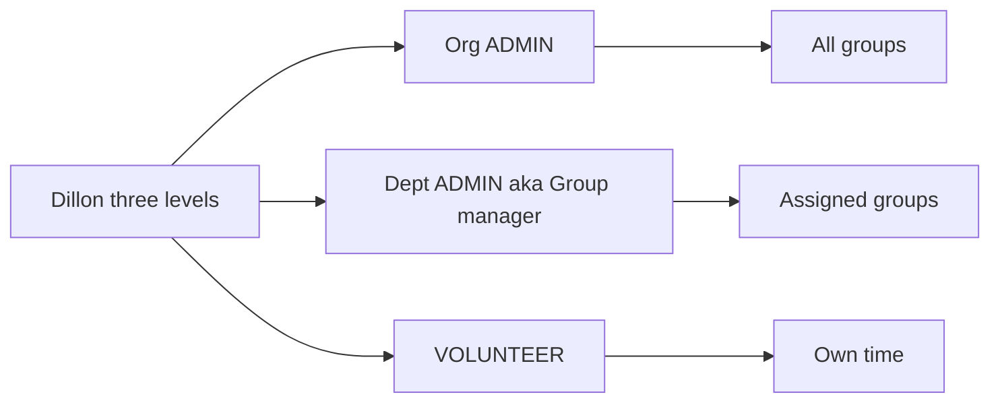

# VolunTime requirements and feedback audit

**Date:** 27 October 2026  
**Audience:** developers  
**Status:** historical snapshot of the 27 October working tree. The C# backend was subsequently retired; see [Prisma adoption](ops/prisma-adoption.md) for the current architecture and rollout.

This historical audit scores the app against the Oct 15 launch brief and Dillon Workman’s Oct 27 staging feedback, answers his five open questions, and lists gaps at that time. The Oct 21 snapshot in [`original-goals-assessment.md`](original-goals-assessment.md) is also historical; do not treat either as current architecture guidance.

## Sources

Under [`docs/base/`](base/):

- [`Volunteer_Hours_Tracker_Project_Brief (1).pdf`](<base/Volunteer_Hours_Tracker_Project_Brief%20(1).pdf>) — 15 October 2026, Dillon Workman (minimum launch)
- [`VolunTime Feedback for Jason.pdf`](base/VolunTime%20Feedback%20for%20Jason.pdf) — 27 October 2026, Dillon Workman (post-staging feedback)
- Brand pack: `CASWJ_Brand_Guidelines_v1_1_DRAFT.pdf`, `Design for Agenda Builder.png`, `caswj-gradient-usage.png`
- Seed workbooks: `2026 Volunteer Hours.xlsx` (named, local-only), `clockify-export-ANONYMIZED-sample.xlsx`

Also: [`schema/domain.md`](schema/domain.md), [`api/http.md`](api/http.md), [`ops/caswj-portal.md`](ops/caswj-portal.md), Next.js (`src/`), Prisma, and `ClockedIn.Api`.

## Verdict

Launch minimums from the brief are largely met: individual accounts, live timer, start/end, total hours, in-kind at $35.47, reports, CSV, 14,609-hour import, and per-role security.

Oct 27 feedback is **closed in the app** except paid-staff vs volunteer in-kind (audit item 16, still out of scope). People can assign Group manager per group, Punch can save unclassified with a banner and email, dashboard cards drill into `/entries`, import rows can Skip or Merge, invite forms preview usernames, and C# now has custom roles, access requests, invite usernames, clock-out placement, and permission-based Access. Portal hosting remains an ops checklist in [`ops/caswj-portal.md`](ops/caswj-portal.md).

We exceeded the internship schema and the two-role brief. That is not the same as done.

---

## Answers to Dillon

These are the recommended replies. They are product decisions, not only a description of current code.

### 1. Does importing people send invitations automatically?

**No.** Import creates accounts immediately. Existing emails are skipped. The optional “Email users welcome credentials after import” checkbox sends the `account-welcome` template (username + temp password), not an invitation. Admins who want the accept-invite flow should use Invite, not Import.

Code: [`src/app/(workspace)/settings/import/import-view.tsx`](<../src/app/(workspace)/settings/import/import-view.tsx>), [`src/lib/api/features/imports.ts`](../src/lib/api/features/imports.ts).

### 2. Can a group coordinator manage more than one group today?

**Yes.** People, invite, and access-request flows assign Member vs Group manager per group. Reports for a coordinator with several department `ADMIN` rows combine those groups.

### 3. Should the timer save without project / task category so people can classify afterward?

**Yes for the timer. No for manual Duration / Total.**

The brief required organization and category because Clockify left them blank. Dillon now wants an unclassified bucket plus a post-stop reminder. Both can be true:

- **Punch:** allow clock-in / clock-out with project, category, and group empty. After stop, show the placement form. Today the confirm dialog cannot edit those fields; they were locked at clock-in. Missing all three = unclassified.
- **Duration / Total:** keep project + category required. Group may stay “Whole organization.”
- **Reports:** add an Unclassified bucket so those hours cannot disappear from grant totals. Notify the volunteer (and their group manager) until they classify or delete.

Do not ship unclassified until notifications exist, or the Clockify “missing fields” problem returns.

### 4. What should we call the levels?

Match volunteer language. Keep the code names. See [Role and label glossary](#role-and-label-glossary).

- CASWJ → model `Organization` → UI **Organization** (CASWJ seed already uses this)
- Symphony, Youth Theatre, and the other affiliates → model `Department` → UI **Group** (already set in [`scripts/caswj-workbook.ts`](../scripts/caswj-workbook.ts) `caswjLabels`)
- Project / event → `Project` → **Project / Event**
- Task category → `TaskCategory` → **Task Category**

Role names to tell Dillon:

- His **Super admin** = org `ADMIN` = UI **Admin** (CASWJ staff). Do not call this Super admin in the product; `User.isSuperAdmin` is a platform flag for ops, not a volunteer-facing role.
- His **Group manager** = `DepartmentMembership` with role `ADMIN` = UI **Group manager** (already used in the user menu)
- His **Volunteer** = `VOLUNTEER`
- Extra level we have: `MEMBER` / **Staff**. Not in his three levels. Keep it as an optional customizable role, or hide it on the CASWJ portal if it confuses people.

### 5. Is sign-up from a public Need the same as self-signup?

**No.** Public Need sign-up creates a **Guest** + `VolunteerSignup`. The optional “Also request an account” checkbox creates an `AccessRequest` for `VOLUNTEER` that an admin approves. It does not create a User or membership.

`/signup` is separate: it creates a User immediately when `PUBLIC_SIGNUP` is on. The CASWJ portal runbook sets `PUBLIC_SIGNUP=false`, so portal visitors should use invite or Need → access request.

---

## Original brief (15 October) — scorecard

| Brief goal                                                                  | Status                      | Notes                                                                                                                               |
| --------------------------------------------------------------------------- | --------------------------- | ----------------------------------------------------------------------------------------------------------------------------------- |
| Replace Clockify + sheet                                                    | Met                         | Web app, timer, manual entry, reports, CSV                                                                                          |
| In-kind $35.47 + professional rates                                         | Met, extended               | Catalog + snapshots. Seed still Volunteer-only                                                                                      |
| CASWJ + eight affiliates                                                    | Met                         | One org, eight `Department` groups                                                                                                  |
| Invite or enrollment                                                        | Met                         | Invite + Add person + public signup. Portal can disable signup                                                                      |
| Roles: volunteer + admin, no approval on entries                            | Met, then extended          | Plus Staff, Group manager, custom roles, SuperAdmin. Entries still live                                                             |
| Settings: orgs, categories, tags                                            | Met, extended               | Projects/events, groups, rates, themes, labels, roles                                                                               |
| Timer, start/end, **total hours**                                           | **Met**                     | Total is in [`time-entry-form.tsx`](../src/components/entity-forms/time-entry-form.tsx). This was the Oct 21 launch gap.            |
| Entry details + entered-by                                                  | Met                         | `userId` vs `enteredByUserId`                                                                                                       |
| Reports by org / category / person / date                                   | Met, extended               | Saved reports, designer, dashboard layout                                                                                           |
| CSV                                                                         | Met, extended               | Log, Summary, plus “this view”                                                                                                      |
| Import 14,609 hours                                                         | Met                         | Golden suite still the grant invariant                                                                                              |
| Clockify fixes (totals, entered-by, shared accounts, required fields, 999h) | Met with Dillon’s follow-up | Punch may leave project / category / group empty; Duration / Total still require placement. Unclassified hours stay in grant totals |
| Agenda Builder brand                                                        | Partial                     | Tokens + mesh gradients on login / empty states. Official flame mark is still waiting on CASWJ files                                |
| Host at `portal.wjarts.org`                                                 | Not met                     | Ops checklist in [`ops/caswj-portal.md`](ops/caswj-portal.md); still on `clocked-in.baddley.us`                                     |
| Per-role security                                                           | Exceeded                    |                                                                                                                                     |
| No real PII in development                                                  | Met                         | Named seed is local / `SEED_ALLOW_REAL_NAMES=1` only; other environments use the anonymized workbook                                |
| Production owned by CASWJ                                                   | Not met                     | Jason’s Vercel / Postgres / Azure                                                                                                   |
| Later: coordinator, staff, paid staff                                       | Partial                     | Coordinator + staff primitives exist; paid staff is not modeled                                                                     |

The 2026 workbook still sums to **14,609.41667 hours** across **249 entries**, **17 unique volunteers**, and **$517,273.91** in-kind. Treat `tests/e2e/caswj-hours.spec.ts` as the grant invariant.

---

## Oct 27 feedback — what landed vs what did not



### Roles and access

| Request                                            | Status | Gap                                                                                                                                         |
| -------------------------------------------------- | ------ | ------------------------------------------------------------------------------------------------------------------------------------------- |
| Three levels; each logs time for people below      | Met    | Admin, Staff, Volunteer, plus Group manager as department `ADMIN`                                                                           |
| Group manager on several groups + combined reports | Met    | People / invite assign Member vs Group manager per group. Reports use assigned groups                                                       |
| Event-level totals without naming people           | Met    | `CollectiveTimeEntry` with `departmentId` null + `participantCount`; needs `log_event_totals`                                               |
| Volunteer requests more access; admin decides      | Met    | Default request is Group manager + groups. Approving writes department `ADMIN` and leaves org Volunteer unless they asked for a system role |
| Custom roles / permissions table                   | Met    | Next and C#. `Role.scope` now drives report, time, and collective list visibility                                                           |

Key files: [`src/lib/permissions.ts`](../src/lib/permissions.ts), [`src/lib/api/access.ts`](../src/lib/api/access.ts), [`src/lib/api/features/roles.ts`](../src/lib/api/features/roles.ts), [`src/lib/api/features/access-requests.ts`](../src/lib/api/features/access-requests.ts), [`ClockedIn.Api/Features/Shared/Access.cs`](../ClockedIn.Api/Features/Shared/Access.cs).

### Inviting and importing

| Request                                                                  | Status       | Gap                                                                             |
| ------------------------------------------------------------------------ | ------------ | ------------------------------------------------------------------------------- |
| First + last name on invite                                              | Met          |                                                                                 |
| Username = first initial + last name; tell admin if taken; number suffix | Met          | Invite form previews `jsmith` / `jsmith1` before send                           |
| Invite subject / preview                                                 | Met          | `{{organizationName}} invited you to join VolunTime`. Next and C# send username |
| Import review list                                                       | Met          | Per-row Import / Skip / Merge. Near-match defaults to Skip                      |
| Duplicate + near-match                                                   | Met          | Email match or chosen near-match can merge; Skip does not create a second user  |
| Does import send invites?                                                | Answered: no | Copy is clear                                                                   |
| CSV templates                                                            | Met          | People and Projects                                                             |
| Drop Groups import                                                       | Met in UI    | API `POST .../imports/departments` still exists                                 |

Key files: [`src/lib/api/features/invitations.ts`](../src/lib/api/features/invitations.ts), [`src/lib/import/username.ts`](../src/lib/import/username.ts), [`src/lib/import/people-review.ts`](../src/lib/import/people-review.ts), [`emails/invitation.tsx`](../emails/invitation.tsx).

### Projects, Needs, classification, reports

| Request                                                              | Status | Gap                                                                            |
| -------------------------------------------------------------------- | ------ | ------------------------------------------------------------------------------ |
| Archive projects (hidden from dropdowns, kept in history)            | Met    | `isActive`; same pattern as rates                                              |
| + New project from time / group / Needs dropdowns                    | Met    | `create_projects` (group managers included)                                    |
| Public Needs page                                                    | Met    | `/openings/[slug]`                                                             |
| Per-need public link                                                 | Met    |                                                                                |
| Group manager posts need → admin approval → manager hears back       | Met    | Coordinators see `/needs` and create needs; publish still uses `approve_needs` |
| Vetting + custom questions                                           | Met    |                                                                                |
| Reminder after stopping timer                                        | Met    | Placement stays editable while the timer runs and is sent on clock-out         |
| Unclassified entries + notify                                        | Met    | Nullable Punch FKs, banner, unclassified email, report bucket                  |
| Hide Tags when none exist                                            | Met    | Hidden for non-admins when `lookups.tags.length === 0`                         |
| Clickable dashboard cards                                            | Met    | Title / slice opens `/entries` with the card filter                            |
| Export what you see; shape columns/filters/sorts; save custom report | Met    | Grant CSVs stay fixed and labeled; `view.csv` follows list/entries cards       |
| Triple-listed groups / (Org) (Type) tags                             | Met    | Seed archives Clockify duplicate projects and `(Org)` / `(Type)` tags          |

Key files: [`src/app/(workspace)/log/own/own-view.tsx`](<../src/app/(workspace)/log/own/own-view.tsx>), [`src/app/(workspace)/dashboard/dashboard-view.tsx`](<../src/app/(workspace)/dashboard/dashboard-view.tsx>), [`src/lib/api/features/volunteer-needs.ts`](../src/lib/api/features/volunteer-needs.ts), [`src/lib/report-layout.ts`](../src/lib/report-layout.ts).

---

## Remaining gaps

Waves 0–5 of the close-gaps plan are in the tree. What is still open:

13. **CASWJ portal hosting and ownership** — ops checklist in [`ops/caswj-portal.md`](ops/caswj-portal.md). Not app code.
14. **Official CASWJ logo files** — do not invent a flame mark. Seed the wordmark/favicon when CASWJ provides them.
15. **Paid staff vs volunteer in-kind** — still out of scope until asked.

`POST .../imports/departments` stays for scripts; the UI does not expose it.

---

## Improvements beyond the brief

These are real. Dillon already named some of them. Do not treat “exceeded” as “done.”

- In-kind value in the product (hours × catalog rate, snapshot on each entry), not a spreadsheet after-the-fact
- Group sessions and event totals (`CollectiveTimeEntry` + `participantCount`), reported separately so they cannot inflate unique-volunteer counts
- Needs board, public catalog at `/openings/[slug]`, per-need public links, vetting questions
- Custom org roles and a permissions matrix (`RolePermission`, 23 keys in [`src/lib/permissions.ts`](../src/lib/permissions.ts))
- In-app access requests (profile + admin decide + Need signup path)
- Saved reports, report designer, dashboard layouts, three CSV endpoints
- Dual HTTP contract (Next.js and `ClockedIn.Api`) and MCP tools
- Themes, wordmarks, entity labels (`Group` vs `Department`)
- JWT sessions, rotating refresh tokens, organization and platform API keys, volunteer-scoped reports
- Multi-tenant product (any signed-in user can create an organization) with a documented CASWJ portal install

The internship `schema.sql` gave every signed-in user full access. VolunTime does not.

---

## Role and label glossary

Volunteer words stay in the UI. Code names stay in the schema.

| Volunteer language         | Model                                     | UI label (CASWJ)           |
| -------------------------- | ----------------------------------------- | -------------------------- |
| CASWJ                      | `Organization`                            | Organization               |
| Symphony, Youth Theatre, … | `Department`                              | Group                      |
| Project / event            | `Project`                                 | Project / Event            |
| Task category              | `TaskCategory`                            | Task Category              |
| CASWJ staff                | `OrganizationMembership.roleId` → `ADMIN` | Admin                      |
| Group leader               | `DepartmentMembership.roleId` → `ADMIN`   | Group manager              |
| Everyone else              | `VOLUNTEER`                               | Volunteer                  |
| Optional extra             | `MEMBER`                                  | Staff                      |
| Platform operator          | `User.isSuperAdmin`                       | SuperAdmin (internal only) |

CASWJ entity labels are seeded in [`scripts/caswj-workbook.ts`](../scripts/caswj-workbook.ts):

```ts
export const caswjLabels = {
  organization: "Organization",
  project: "Project / Event",
  department: "Group",
  taskCategory: "Task Category",
};
```

Default product labels (non-CASWJ orgs) are Organization / Project / Department / Task category in [`src/lib/labels.ts`](../src/lib/labels.ts).

Group-manager capabilities are not a role code. They are `DepartmentMembership` with `ADMIN` plus the merge of `groupManagerPermissions` in [`src/lib/api/access.ts`](../src/lib/api/access.ts): invite, log own and member time, log group sessions and event totals, view/export reports, create needs, create projects.
